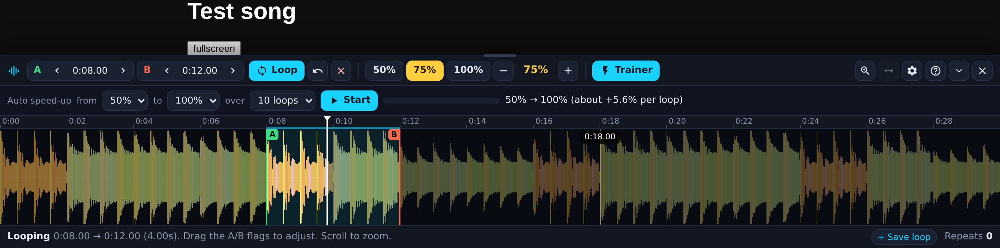

# DJ Wave Looper for YouTube

A Chrome extension for practising music on YouTube. It's made for singers learning by ear and for instrument players.



- **See the whole song as a DJ waveform** in a panel at the bottom of the page. Colours show the sound: orange/red = bass, green = mids, blue = highs.
- **Loop any part:** click where it starts, then click where it ends. It loops forever.
- **Slow it down:** 30%, 50%, 75% and 100% buttons, plus − / + in 5% steps. The key stays the same, so you can still sing along.
- **Studio-quality slow-down:** when you slow a song down, the sound goes through a studio time-stretch engine (like warping in a DAW) instead of the browser's basic one, so voices and instruments stay clean, without the robotic, watery sound. At 100% the sound is untouched. You can switch it off in ⚙ (**Studio-quality slow-down**).
- **Speed trainer:** tap **Trainer** and it starts right away at 30%. Every loop gets a little faster: **10, 30 or 50 loops** up to 100%, then **5, 10 or 10 more at 100%**, and it stops by itself. Tap **Trainer** again to stop and go back to normal speed. **Too fast?** Press a slower speed while it runs: the trainer steps back to the loop that plays at that speed, so you get those loops again.
- **Lyrics next to the wave:** tap **Lyrics** (♪). It reads the song name from the YouTube title (it ignores words like *Official Video*, *Acapella*, *Instrumental* or *Remastered 2009*, and understands titles like `Song | Artist`, `BTS 'Dynamite'`, `周杰倫【告白氣球】` or `YOASOBI「夜に駆ける」`) and finds the lyrics in [LRCLIB](https://lrclib.net), a free lyrics database. When the lyrics have timings, the current line lights up and scrolls along, and you can tap a line to jump there. **Practise one line:** tap the ⟳ at the left of a line (or the left edge of the line). That line speeds up from 30% to 100% with the Trainer's counts (10 plays, then 5 at 100% by default), then it stops and your speed goes back to what it was (a running Trainer keeps its place). Tap ⟳ again to stop early: your speed comes back and the song carries on (your A–B loop if you have one). The line shows on the wave in purple with **[ ]** edges: drag them to make the line loop start earlier or end later, just like the A / B flags. Wrong song? Tap ⏭ for the next match, or type the song name and artist and press Enter. For **a cappella / vocals-only** videos the lyrics line themselves up with where the singing starts, and music videos with silence before the song skip that silence; for any version you can fine-tune the timing with **◀ 0.1s / 0.1s ▶** (saved per video).
- **Everything for the loop sits right above the wave:** play / pause, **A** / **B** with their ‹ › buttons, **Loop**, undo and clear. Speeds, the Trainer and the view buttons are in the top row.
- **Song parts:** small labels like **VERSE 1**, **PRE-CHORUS**, **CHORUS**, **BRIDGE**, **OUTRO** sit above the lyrics. They come from the chord sheet when you paste one, otherwise the looper works them out from the lyrics (lines that come back are the chorus, the part before each chorus is the pre-chorus, a one-off part late in the song is the bridge).
- **Practice (one button, top right of the lyrics):** the whole song, part by part. Each part speeds up from 30% to 100% (the Trainer's 10 / 30 / 50 loops), plays 5 or 10 times at 100%, then the next part starts by itself. When every part is done the whole song plays once from the start at 100%, then it stops. Optional rest between parts in ⚙. Press ▶ during a rest to go on straight away; tap **Practice** again to stop.
- **Chords like Ultimate Guitar:** tap **Chords** → **Find on Ultimate Guitar** (opens the search for this song). On the chords page select all and **Copy**, come back and tap **Paste**. The chords (Fmaj7, Fm7, B7b13, C/E…) are placed over the exact word where they change, intro chord rows and section names included; lines the sheet wrote only once (a repeated chorus) get their chords too. **♭ / ♯** transposes. Saved per video. (Ultimate Guitar has no public API and doesn't allow other apps to pull its pages, so this copy-and-paste is the reliable way; ChordPro text like `[Am]Hello [F]world` works too.)
- **Loop from the lyrics → Trainer:** tap **A** at the right of the first line and **B** on the last line: exactly those lines loop and the Trainer starts on them.
- **Timing you can trust:** lyrics move in **0.1 s** steps. For a cappella videos the looper finds where every line's singing starts in the waveform and lines each lyric line up with it (not just the first line), so loops start right on the first syllable.
- **Pause between loops** (0.5–3 s) to breathe before each repeat.
- **Saved parts** (Verse, Chorus…). Your loop and speed are remembered for every video.

## Install (2 minutes)

1. Download this repository (green **Code** button → **Download ZIP**) and unzip it.
2. Open Chrome and go to `chrome://extensions`.
3. Turn on **Developer mode** (top right).
4. Click **Load unpacked** and pick the unzipped folder (the one with `manifest.json` in it).
5. Open any YouTube video. You'll see a new waveform button in the player controls (bottom right of the video). You can also click the extension icon or press **Alt+L**.

## iPhone and iPad (Safari)

Chrome on iPhone/iPad can't run extensions, so there is a **script version** that runs in Safari through the free **Userscripts** app. Same panel and features, made for fingers:
- **DJ wave:** the wave scrolls under a playhead in the middle. Slide your finger on the wave and the song moves with it, like a record. **A quick tap on the wave pauses / plays.** Holding your finger still holds the song; lift it to play on.
- **Double-tap the wave** to set **A** right there, then double-tap again where the part ends to set **B**: the loop starts playing. (A double tap never pauses the song.)
- **For drummers (laptop Chrome):**
  - **Drums view** (on by default on a computer): the wave is split into three layers like a DJ deck, kick and bass in **red**, the middle in **amber**, snare and hi-hats in **white**, each scaled on its own so quiet hi-hats still show. Under the wave, **drum lanes** mark every **kick (KK)**, **snare (SN)** and **hi-hat (HH)** hit, like a drum chart.
  - **Beat grid:** the looper finds the tempo (BPM) and every beat, following a drummer who drifts a little, and finds the **1** of each bar (kick on 1 and 3, snare on 2 and 4). Bar lines carry the bar number; zoom in and you see **1 2 3 4** on every beat.
  - **Q (auto quantize):** turn it on and A and B always land exactly on a beat, whether you click, drag, move a flag or press [ ]. ‹ › then move A or B by one beat. Key: **q**.
  - **Beat loops 1 · 2 · 4 · 8 · 16:** like a DJ controller, loop that many beats from the beat you're on. Press another size while it loops and the length changes from the same start.
  - Grid wrong? **½** / **2×** fix the tempo, **1▸** moves the bar start one beat. Saved per video.
- **DJ waveform:** coloured like Serato (red bass, green mids, blue highs) with a soft outer shape and a bright body, the played part greyed and a glowing playhead.
- **A / B like a DJ app (loop in / loop out):** tap the wave to stop, drag the wave to where the part starts and tap **A**, drag on to where it ends and tap **B**: it loops. As soon as both are set, the loop plays by itself. Drag the green **A** / red **B** flags anywhere (the A flag too, while it waits for B), or use ‹ › to move them by 1 second.
- **Loop from the lyrics:** each lyric line has an **A** button at its right. Tap it on the first line of the part, then tap **B** on the last line: exactly those lines loop and start playing (A and B on the same line = just that line). The looped lines are marked green / red at the edges.
- **↺ 5s** jumps back 5 seconds and plays (inside a loop it goes back to the loop start). **5s ↻** skips 5 seconds ahead.
- **Half and half:** the looper takes the bottom half of the screen, the lyrics fill the top half with big words. **A− / A+** change the word size, and the bar under the lyrics drags to make them taller or shorter. The layout button moves the lyrics back beside the wave.
- **Play / pause** button a little bigger than the others.
- **Pinch to zoom**, **Whole song** to see everything, tap the little map under the wave to jump.
- A round floating button opens the looper.
- **Voice calls:** the video keeps playing during a call (⚙ **Play along with voice calls**, on by default on iPhone/iPad; the silent switch / silent mode mutes it).
- **Tap the video** to pause / play.

1. Install **Userscripts** from the App Store (free; icon is `</>`).
2. Open the Userscripts app once and tap **Change Userscripts Directory**. Pick a folder, for example *On My iPhone → Userscripts*.
3. Save `wave-looper.user.js` into that folder. Get it from the `userscript` folder of this repo, or from the file sent to you. In Files, *Move* it into the Userscripts folder.
4. Go to **Settings → Apps → Safari → Extensions → Userscripts**. Turn it on and set **Permissions → youtube.com → Allow**. (On older iOS: *Settings → Safari → Extensions*.)
5. Open **youtube.com** in Safari and play a video. Tap the round **waveform button** at the bottom right. If Safari asks, tap **ᴀA → Userscripts → Always Allow on this website**.

Notes:
- **iPad** works best. Safari shows YouTube's desktop site there, the same one the Chrome version was built and tested on.
- **iPhone** uses the mobile site (m.youtube.com). Loop, speed and trainer work. The waveform needs YouTube to stream the audio the same way it does on desktop. If the wave stays empty on your iPhone, the loop and speed still work. Tell me and I'll look into it.
- Videos opened in the **YouTube app** can't be controlled. Use youtube.com in Safari.
- The same file also works in Tampermonkey or Violentmonkey on any desktop browser.

## How to use

| What you want | What to do |
|---|---|
| Make a loop | Click the wave at the start, then click at the end. Or drag across the part. |
| Fine-tune the loop | Drag the green **A** / red **B** flags (or the purple **[ ]** of a lyric-line loop), or use the ‹ › buttons (0.05 s; Shift = 0.01 s, Alt = 0.5 s). |
| Zoom in / zoom out | Press **Zoom in**: the wave shows only about 30 s around what is playing and scrolls along with the song. Press **Whole song** to see everything again. You can also scroll on the wave to zoom, and 🔍 zooms to your loop. |
| Open the looper | Waveform button in the video controls (bottom right), the **Wave Looper** button under the video next to Like/Share, the extension icon, or **Alt+L**. |
| Make the wave bigger | Press the ↕ buttons (top right of the panel), or drag the top edge of the panel up. |
| Jump somewhere | Click the time ruler at the top of the wave. |
| Set A/B while listening | Press **[** at the start and **]** at the end. |
| Loop on/off | **Loop** button or **\\**. |
| Slow down | **50% / 75% / 100%**, or − / +. Click the big % number to reset to 100%. |
| Speed trainer | Tap **Trainer**: it starts right away at 30% → 100% over 10 loops, then 5 at 100%. Choose *from* (30/50/75%) and 10 / 30 / 50 loops (then 5 / 10 / 10 at 100%) any time. Tap **Trainer** again to stop and go back to normal speed. |
| Lyrics | Tap **Lyrics** (♪). They're found automatically from the song name; the current line lights up when the lyrics have timings. Tap a line to jump there. ⏭ = next match; or type the song name and press Enter. |
| Play / pause | ▶ / ❚❚ button in the row right above the wave, next to **A** / **B**. |
| Breathing pause, pitch, sound quality | ⚙ settings. **Studio-quality slow-down** is on by default; turn it off if your computer struggles. Turn **Keep pitch** off for tape-style slow-down (50% = one octave lower, handy for working out fast solos). |
| Undo a loop change | ↶ button. |
| Turn it all off | ✕ closes the panel and resets speed to 100%. |

Space, the arrow keys and every other YouTube shortcut keep working as usual.

### About the waveform "reading"

YouTube only downloads the song a little at a time. The first time you open a song, the looper **reads the whole song**: it plays it muted at high speed for a few seconds (usually 5–20 s), then puts you back exactly where you were. After that the wave is saved, so it shows instantly next time. You can turn this off in ⚙. If you do, the wave fills in as you listen, or you can press **Read whole song** whenever you like.

Works on `www.youtube.com` (watch pages, theatre mode and fullscreen) and `music.youtube.com`.

## For developers

```
src/inject.js     page-world tap: reads the audio YouTube feeds to Media Source Extensions, decodes it, makes waveform peaks
src/content.js    panel UI, loop engine, speed + trainer, scan, storage
src/core.js       pure logic (time format, trainer ramp, PeakStore), unit tested
src/panel-css.js  panel styles (inside a shadow root)
src/background.js toolbar button + Alt+L
src/vendor/signalsmith-stretch.js  Signalsmith Stretch 1.3.2 (MIT, Geraint Luff): pitch/time-stretch AudioWorklet
```

```
node tools/make-fixtures.js   # test media (needs ffmpeg)
npm test                      # unit tests: logic + WebM/MP4 parsers
npm run e2e                   # loads the real extension in Chromium on a simulated YouTube page (needs playwright)
npm run e2e:userscript        # same steps against the userscript build
npm run e2e:mobile            # userscript on an emulated iPhone visiting m.youtube.com (touch, pinch, layout)
npm run e2e:ipad              # userscript on an emulated iPad (Safari's desktop site with touch)
npm run build:userscript      # userscript/wave-looper.user.js (Safari/iOS, Tampermonkey); built from src/
npm run zip                   # dist/dj-wave-looper.zip for the Chrome Web Store
```

The end-to-end test serves a fake YouTube watch page that streams media through MSE the way YouTube does, with YouTube's Trusted Types policy. It covers 41 steps, including a pitch check that 50% speed still sounds at the right pitch (440 Hz stays 440 Hz): scan and position restore, waveform accuracy, making the wave bigger, the click-click loop, loop timing (under 80 ms overshoot), speed buttons, YouTube resetting the speed, the trainer ramp, the trainer stopping after N full-speed plays, the button under the video, flag dragging, nudge, undo, zoom, keyboard keys, breath pause, saved parts, the end-of-video guard, switching videos, ads, fullscreen and console errors.

## Credits

Slow-down audio uses [Signalsmith Stretch](https://github.com/Signalsmith-Audio/signalsmith-stretch) by Geraint Luff / Signalsmith Audio, MIT licence (see the header of `src/vendor/signalsmith-stretch.js`). Lyrics come from [LRCLIB](https://lrclib.net).
