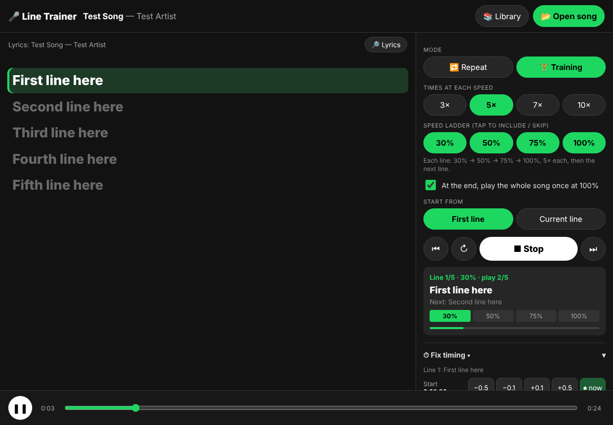

# 🎤 Line Trainer (iPad / iPhone / any browser)

A standalone app for learning songs line by line. Open a song file, and synced lyrics are found automatically. Then loop each line at the speed you want, or run the training ladder.



## Open it on your iPad

1. In **Safari**, open:
   **https://raw.githack.com/948573034jackie-cpu/meh/spotify-line-trainer/line-trainer-app/dist/line-trainer.html**
2. Tap **Share (□↑) → Add to Home Screen**. It now opens full-screen like an app.
3. Tap **📂 Open song** and pick an **mp3 / m4a** from the Files app.

Songs you open are kept in **📚 Library**, so you only pick a file once.

> Spotify songs can't be used: Spotify's audio is encrypted, and its API won't control playback on a free account. Use song files you own (bought downloads, your own recordings, and so on), saved in the Files app.

## 🔗 Follow my Spotify (automatic, works with free Spotify)

Spotify can't be read by other apps on a free account, but Spotify reports what you play to **Last.fm** (free). Set it up once:
1. Make a free account at last.fm/join.
2. At last.fm/settings/applications, connect **Spotify Scrobbling**.
3. Get a free API key at last.fm/api/account/create.
4. In the app, tap **🔗 Follow my Spotify** and enter your username and the key.

From then on, play any song in Spotify. Within a few seconds the app shows it, loads its synced lyrics, and plays the **same recording from YouTube** (the "– Topic" upload of the same length) in its own player, with speed control. Pause Spotify and press ▶ Start. If you're in the middle of training, it asks before switching.

You can also paste a Spotify song link (**🎵 Spotify link**) or open a song file (**📂 Open file**).

## Features

- **🔁 Repeat:** every line 3 / 5 / 7 / 10× at 30 / 50 / 75 / 100% speed (the voice keeps its pitch).
- **🎯 Practice:** each line plays 10× speeding up from 30% to 100%, then 10× at 100% (20 total). Then it rests 0 / 20 / 30 / 40 s before the next line. All counts can be changed.
- **🏋️ Training:** each line at 30% → 50% → 75% → 100% (5× each by default), then the next line. At the end, the whole song plays once.
- **Lyrics found automatically** from LRCLIB (free, open synced-lyrics database). It picks the version whose length matches your file. **🔎 Lyrics** lets you search by hand or paste LRC lyrics.
- **🎯 Auto-sync:** the app *listens to the song* and shifts all the lyrics so each line starts when the voice starts. It runs automatically when lyrics are loaded.
- **🎯 Snap each line:** fine-tunes every line's start onto the voice (within ±0.35 s).
- **⏱ Fix timing:** start/end ±0.1/±0.5 s, **⏺ now**, whole-song earlier/later, join/split lines, reset. Saved per song.
- **Next song automatically:** when a song is done, training continues with the next song in your Library.
- **Tap any lyric** to jump there (or to loop that line while training).

## Development

```
node build.js                                   # bundles src/ + ../spotify-line-trainer/src/core.js into dist/line-trainer.html
NODE_PATH=$(npm root -g) node test/e2e.js       # end-to-end tests (Playwright, iPad viewport, mock LRCLIB)
```
