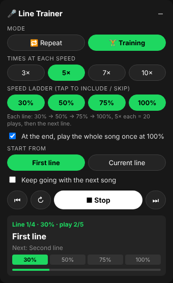

# 🎤 Spotify Line Trainer (Chrome extension)

Loops every lyric line of the song playing in the **Spotify Web Player** (open.spotify.com), so you can learn to sing it line by line.



## Modes

| Mode | What it does |
|---|---|
| 🔁 **Repeat** | Each line plays **3 / 5 / 7 / 10×** at **30 / 50 / 75 / 100 %** speed, then moves to the next line, first to last. |
| 🏋️ **Training** | Each line plays 5× at 30 %, 5× at 50 %, 5× at 75 %, 5× at 100 %, then the next line. When the last line is done, **the whole song plays once from the start at 100 %**. You can change the repeat count, take speeds out of the ladder, and turn off the whole-song replay. |

The voice keeps its normal pitch when slowed down. You can also:
- start from the **first line** or the **current line**
- use ⏮ / ↻ / ⏭ to go to the previous line, restart the line, or skip to the next line
- turn on **Keep going with the next song** so the next song starts automatically
- change speed or repeat count while it runs

If you drag Spotify's progress bar, the trainer moves to that line. If you pause, it waits.

## Install (about 1 minute)

1. Download this folder (`spotify-line-trainer`).
2. In Chrome, open `chrome://extensions` and switch on **Developer mode** (top right).
3. Click **Load unpacked** and choose the `spotify-line-trainer` folder.
4. Open https://open.spotify.com, play a song that has lyrics, and click **▶ Start** in the green panel at the bottom right (use **–** to shrink it to a 🎤 button).

## Install on iPad / iPhone (Safari, no computer needed)

1. Install the free app **Userscripts** (by Justin Wasack / quoid) from the App Store.
2. Open the **Userscripts** app once and tap **Set Userscripts Directory**. Pick any folder, for example a new folder "Userscripts" in *On My iPad*.
3. Go to **Settings → Apps → Safari → Extensions → Userscripts**. Turn it **on** and set **open.spotify.com** to **Allow**. (On older iPadOS: Settings → Safari → Extensions.)
4. In Safari, open this link:
   https://raw.githubusercontent.com/948573034jackie-cpu/meh/spotify-line-trainer/spotify-line-trainer/dist/spotify-line-trainer.user.js
   Tap the **puzzle-piece / ᴀA** icon in the address bar → **Userscripts** → **Install**, then confirm.
5. Open **https://open.spotify.com** in Safari, log in, play a song with lyrics, and tap **▶ Start** in the green panel.

Tips for iPad:
- Keep Safari open and in front while training. iPadOS may slow down background tabs.
- If the panel says *"Start playing a song first"*, tap Spotify's play/pause once and press Start again.
- If Safari shows "browser not supported", tap **ᴀA → Request Desktop Website**.
- The script works the same in Tampermonkey (Chrome, Firefox, Edge) using the same link.

## Why a Chrome extension rather than an app?

- Spotify's desktop and mobile apps no longer allow third-party add-ons, and the official Spotify Web API **cannot change playback speed**. Its seek commands also go over the network, which is too slow and imprecise to loop single lines.
- In the browser, the extension controls the web player's own audio element. That gives exact speed (0.3×–1×, pitch kept) and instant seeking. It also reads Spotify's own time-synced lyrics (the ones the 🎤 lyrics view shows).

## Notes / limits

- Only songs that show **time-synced** lyrics in Spotify work. The panel says so when a song has no lyrics or unsynced lyrics.
- If lyrics won't load, click Spotify's 🎤 lyrics button once and press Start again.
- Spotify can change its website at any time. If an update breaks something, the parts most likely to need adjusting are the CSS selectors in `src/page.js` (`currentTrackId`, the play button, the lyrics button).

## Development

```
src/core.js   pure logic: lyrics parsing, repeat/training plan (unit-tested)
src/page.js   runs inside the Spotify page: finds the audio element, loads lyrics, loops lines
src/ui.js     the floating control panel (shadow DOM), settings saved in chrome.storage / localStorage
build-userscript.js   bundles src/ into dist/spotify-line-trainer.user.js (iPad / Safari version)
test/         node unit tests + Playwright end-to-end tests against a mock open.spotify.com
```

```
node --test test/core.test.js                  # unit tests
node build-userscript.js                       # rebuild the iPad userscript after editing src/
NODE_PATH=$(npm root -g) node test/e2e.js      # end-to-end as Chrome extension (needs playwright + chromium)
MODE=userscript NODE_PATH=$(npm root -g) node test/e2e.js   # as userscript (document-start)
MODE=late NODE_PATH=$(npm root -g) node test/e2e.js         # as userscript injected after page load
```
